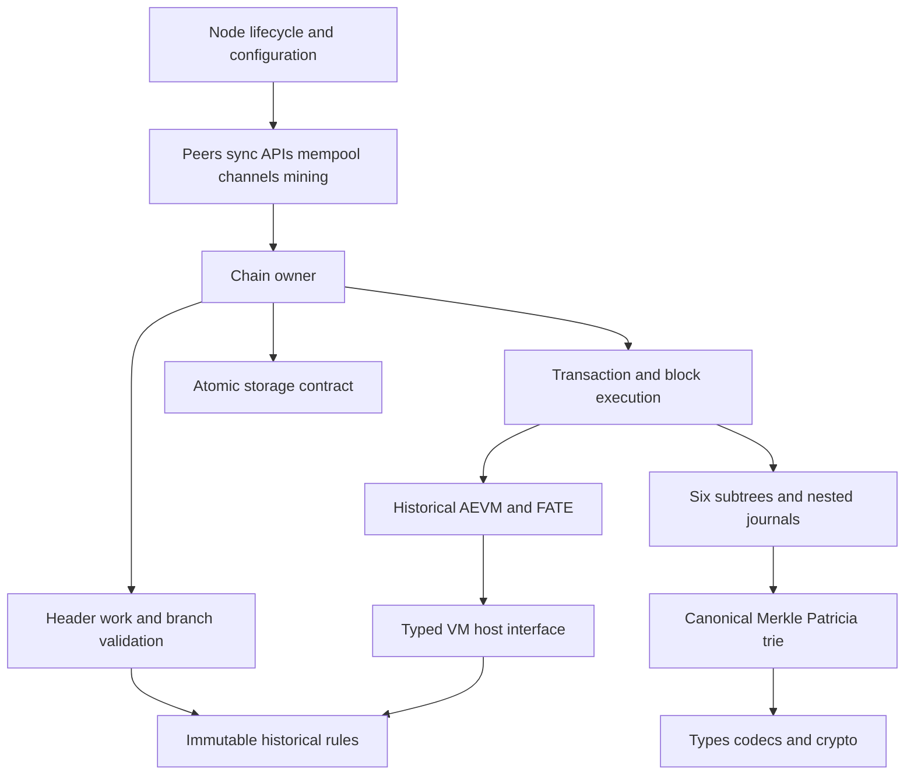

# Rust node architecture

Build a modular single-process node with a deterministic execution core and asynchronous networking around it. Preserve the existing mainnet's canonical bytes, hashes, historical state transitions and branch selection. The architecture is a design baseline; none of the components below is implemented yet.

## Core boundaries

One chain service owns canonical commits. Concurrent workers validate independent signatures, headers and PoW against immutable parent views; transaction execution preserves canonical order. Results carry their parent and generation identity so a reorg cannot make stale work overwrite the new tip. APIs, candidates and simulation use captured read views.

The intended package boundaries are:

| Layer | Packages and responsibility |
| --- | --- |
| Canonical data | `ae-types`, `ae-crypto`, `ae-codec`: exact typed values, cryptographic operations and serialized bytes |
| Rules and state | `ae-protocol`, `ae-trie`, `ae-state`: immutable network rules, exact authenticated nodes, state objects and journals |
| Execution | `ae-vm-interface`, `ae-vm-aevm`, `ae-vm-fate`, `ae-execution`: historical interpreters, shared host primitives and transaction/block effects |
| Chain and persistence | `ae-consensus`, `ae-store-api`, `ae-storage`, `ae-chain`: contextual validation, durable batches, branch graph and canonical publication |
| Services | `ae-mempool`, `ae-p2p`, `ae-sync`, `ae-api`, `ae-channels`, `ae-mining`: bounded I/O and policy around the core |
| Composition and proof | `ae-node`, `ae-compat`: configuration/lifecycle and independent fixture comparison |
| Later products | Stratum, Hyperchains and active monitoring, each with separate enablement and acceptance gates |

Add each package with its first real behavior. Do not create empty crates merely to match the table. Runtime VM callbacks go through `ae-vm-interface`; the interpreter does not import the transaction executor. Storage implements the core's read/write interfaces rather than exporting engine handles to execution. Operational dependencies must not enter the deterministic core.

## Historical compatibility

The reference [fork schedule](https://github.com/aeternity/aeternity/blob/fa2a6d714e7f94c5edb508f9e04dc27b491968c6/apps/aecore/src/aec_hard_forks.erl) activates Roma, Minerva, Fortuna, Lima, Iris and Ceres. Select explicit immutable rules from network and block context. Arcus and Salus exist in the reference source without mainnet activation in this baseline; do not enable them by selecting the latest enum or implementation.

Preserve key versus microblock semantics, Cuckoo proof validation, target arithmetic, timestamps, delayed rewards, the community checkpoint and fork migrations. All transaction families remain necessary, including GA/paying-for nesting, name/oracle expiry, and on-chain channel proofs and force progress. Interactive channels can be delivered later without disabling their on-chain transactions.

Preserve historical AEVM and FATE variants, contract creation versus call admission, storage generations, map ordering, gas, return bytes, logs and failure effects. A modern EVM or current Sophia compiler cannot replace historical bytecode execution. Dry-run's selected simulation behavior is separate from block validity. The [VM dispatcher](https://github.com/aeternity/aeternity/blob/fa2a6d714e7f94c5edb508f9e04dc27b491968c6/apps/aecontract/src/aect_dispatch.erl) and [FATE engine](https://github.com/aeternity/aeternity/blob/fa2a6d714e7f94c5edb508f9e04dc27b491968c6/apps/aefate/src/aefa_fate.erl) are part of the behavioral reference.

Use nested state journals for blocks, transactions, authentication and calls. The executor determines which effects survive failure; an error cannot automatically discard all charges or call records. State roots include the original six subtrees in the original order. Expiry structures must also be retained or deterministically rebuilt even where they are outside the committed root set.

Execution receives time, height, network, protocol, call/authentication context and state explicitly. It cannot read system time or mutable configuration. Use exact numeric domains, checked arithmetic and explicit historical ordering; Rust hash-map iteration and automatic integer narrowing cannot determine consensus output.

## Storage and existing data

Use a versioned Rust-owned schema with an initial RocksDB adapter. Immutable trie nodes, state roots, block records and canonical indexes become visible through an atomic commit contract. Readers hold consistent views. Reorgs publish complete detach/attach changes, and restart recovery checks the last committed generation before readiness.

The three data promises are distinct:

1. Decode and verify canonical headers, blocks and transactions from the existing network.
2. Replay genesis and all historical transitions to reproduce state roots.
3. Import an existing database through an explicit versioned exporter/importer.

Direct opening of Mnesia/RocksDB directories is outside the initial contract. The [reference database](https://github.com/aeternity/aeternity/blob/fa2a6d714e7f94c5edb508f9e04dc27b491968c6/apps/aecore/src/aec_db.erl) contains Erlang record/term conventions beyond the underlying engine.

An interchange manifest records network/genesis, source revision, anchor hashes, roots, auxiliary state, ancestor context, chunk checksums and trust mode. Import into staging, validate canonical objects and recompute roots before publication. A matching snapshot root binds state to a header but does not prove every historical transition. Checkpoint operation must disclose its trusted anchor; independent historical validation requires replay.

## Services and operational policy

Use Tokio for asynchronous services and bounded workers for CPU-heavy work. Keep the Noise handshake, prologue, message versions and framing compatible with the [reference peer transport](https://github.com/aeternity/aeternity/blob/fa2a6d714e7f94c5edb508f9e04dc27b491968c6/apps/aecore/src/aec_peer_connection.erl). Downloaded or decoded data is not validated data. Queue/resource limits defer work or reject service requests without creating new block-validity rules.

Preserve v2/v3 API contracts and implemented Rosetta behavior, with explicit unsupported routes. Mempool minimum fees are local policy, separate from consensus fees. Candidate production uses the shared executor. Mining solvers, keys, interactive channel sessions and optional funded monitoring have separate ownership and enablement.

Startup checks profile/schema identity and recovers storage before readiness. Shutdown stops admission, resolves the atomic commit boundary and waits for owned tasks. Critical state-task failure stops the node for recovery; peer-session failure can remain isolated. Logs, metrics and status report actual validation stages and capabilities.

## Proof before optimization

Fixtures pin source, dependencies, generated artifacts, protocol/VM, inputs and reference outputs. Compare exact bytes, roots, gas, return values, logs and failure effects. Fuzz malformed inputs and preserve minimized failures. Reconcile the baseline with the observed deployed revision before choosing the reference executable; both are recorded in [upstream.json](../reference/upstream.json).

Use compact offline fixtures and tiny isolated development networks locally. Dedicated infrastructure is required later for historical replay and shadow validation. No full mainnet/UAT node is part of the developer workflow. See the [delivery gates](roadmap.md).
